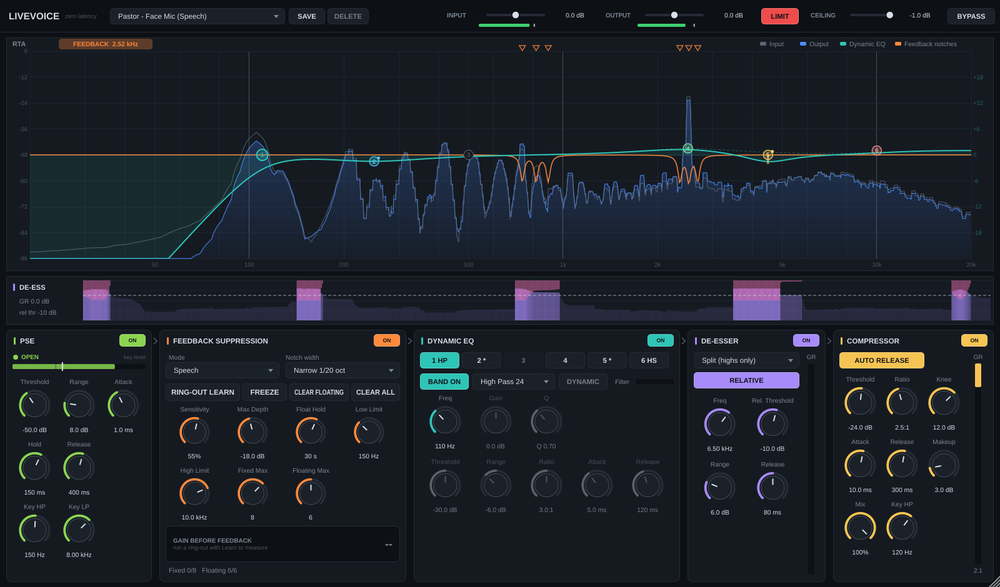

# LiveVoice — zero-latency vocal processor (VST3)

A single VST3 plugin for live voice: pastor on a face mic, lectern speech, male and female vocals.
Everything in the audio path is zero latency (the plugin reports 0 samples to the host).



## What's in it

**Signal flow** (the bottom panels are laid out in this order, left to right):

Input trim → **PSE** → **Feedback notches** → **6-band Dynamic EQ** → **De-esser** → **Compressor** → Output trim → Safety limiter

| Section | What it does |
|---|---|
| **RTA** (top) | Input (grey line) and output (blue fill) spectrum, the live dynamic-EQ curve (solid teal, dashed = static setting), and the feedback notch curve (orange). Notch markers sit along the top edge: filled = fixed, outline = floating. |
| **De-ess histogram** (middle strip) | Scrolling ~5 s history of sibilance level (violet). Bars turn bright and pink reduction hangs from the top whenever the de-esser is working. Dashed line = threshold. |
| **Feedback suppression** | Automatic detection + narrow notches. Modes: **Speech**, **Singing**, **Multipurpose**. |
| **Dynamic EQ** | 6 bands. Band 1: Bell / Low Shelf / HP 12 / HP 24. Band 6: Bell / High Shelf / LP 12 / LP 24. Any bell or shelf can be made dynamic (threshold, range ±18 dB, ratio, attack, release). |
| **PSE** (Primary Source Expander) | Smoothly turns the mic down between phrases: less stage bleed and room pickup, and less chance of feedback building while the mic is idle. Threshold, range, attack, hold, release, key HP/LP filters, open/closed lamp and key-level meter. |
| **De-esser** | Split (reduces only the highs) or Wideband. Freq 2–12 kHz, threshold, range, release. **RELATIVE** button switches between absolute detection (fixed level) and relative detection (sibilance compared with the whole voice). |
| **Compressor** | Transparent, smooth vocal compressor at the output: RMS detection, soft knee, key high-pass, dB-domain smoothing, opto-style **AUTO RELEASE**, makeup and parallel mix. |
| **Header** | Presets, input/output trim with meters, safety limiter + ceiling, bypass. |

### Using the RTA directly
- Drag a numbered EQ handle: left/right = frequency, up/down = gain.
- Mouse wheel over a handle = Q. Double-click a handle = gain back to 0 dB.
- Clicking a handle also selects that band in the EQ panel (and the reverse).
- Click a notch marker (top edge) to **remove** it or **make it fixed**. Hover shows its frequency and depth.

## Feedback suppression — how to use it at church

1. **Before the service (ring-out):** set the mic where it will be used, turn **RING-OUT LEARN** on, and slowly raise the channel/master gain until rings start. LiveVoice notches each one and marks it *fixed*. Stop when you have a few dB of headroom past your service level, pull the gain back, turn Learn **off**.
2. **During the service:** leave suppression **on**. New rings get *floating* notches, which release automatically after **Float Hold** seconds once the frequency stops ringing.
3. Fixed notches are saved with your host session/snapshot and come back next week. **FREEZE** stops all detection and holds every notch as-is. **CLEAR FLOATING** drops only the in-show notches; **CLEAR ALL** (asks first) also drops the ring-out.

**Modes**
- **Speech** — fastest response (pastor, announcements).
- **Singing** — more patient, so held sung notes are not mistaken for feedback.
- **Multipurpose** — in between, for someone who both speaks and sings.

**Detection** runs on a background thread (FFT on a copy of the audio), so it never adds latency. A peak is called feedback only if it is well above the overall spectrum, much sharper than its neighbourhood, has no harmonics (voices do), is pitch-stable (voices wobble, rings don't) and persists or grows. A fast path catches a rapidly growing, pitch-locked howl before the full persistence time.

**Limits that keep it safe:** Fixed Max / Floating Max (up to 12 each), Max Depth (−3 to −30 dB), notch width (1/5 to 1/40 octave, default 1/20), and a Low/High detection range (default 150 Hz – 10 kHz, so the warmth of the voice is never notched).

### Gain before feedback readout
The tile in the Feedback panel shows how much gain the ring-out bought you. While **Learn** is on, LiveVoice notes its own gain (INPUT + OUTPUT + compressor makeup) at the **first ring**, then the **highest gain that held for 4 s without a new ring**. The difference is the readout (e.g. "+6.5 dB"). It stays after you switch Learn off, is saved with the session, and starts fresh the next time you turn Learn on.

Important: the plugin can only see its own gain. **During ring-out, raise the gain with LiveVoice's INPUT or OUTPUT, not the console fader**, then bring it back to service level afterwards.

## PSE — setting it up
Watch the key-level bar while the pastor talks: set **Threshold** just under the softest speech (the white mark), with **Range** 6–12 dB for a natural result. The thin grey mark is where it starts closing (4 dB of hysteresis), and **Hold** keeps it open through short gaps between words. Key HP/LP decide what the PSE listens to (default 150 Hz–8 kHz ignores rumble and cymbals). The bar keeps working with PSE off, so you can set the threshold before switching it on.

## Compressor — why it's built this way
Aimed at "you don't hear it working": an RMS detector reacts to loudness rather than spikes; a key high-pass (default 100 Hz) stops plosives and proximity boom pumping the voice; a wide soft knee eases in; gain changes are smoothed in the dB domain (the cleanest approach); and AUTO RELEASE behaves like an optical compressor — quick recovery after a short peak, slower and gentler after sustained compression. Starting point: threshold so you see 3–6 dB GR on normal speech, 2.5–3:1, auto release on, makeup to match.
Note: makeup gain raises the channel's gain between words too, so it counts toward feedback just like a fader move.

## Presets

Factory: *Default, Pastor – Face Mic (Speech), Spoken Word – Lectern Mic, Male Vocal – Handheld, Female Vocal – Handheld, Worship Leader – Speak & Sing.* They are starting points to adjust at soundcheck. All of them except Default switch the compressor on; the speech presets use relative de-essing; PSE is switched on only in the Lectern preset (where nobody may be standing at the mic) and set up but off in the others.

**SAVE** captures your own presets (they appear under *My presets*; **DELETE** removes one). Files live in:
- Windows: `%APPDATA%\LiveVoice\Presets`
- macOS: `~/Library/Application Support/LiveVoice/Presets`

A preset stores the **voice settings** (PSE, feedback behaviour, dynamic EQ, de-esser, compressor). It deliberately does **not** change input/output gain, the limiter, bypass, Learn/Freeze, or your learned notches — so switching presets mid-service never changes gain staging or forgets the ring-out.

## Building

Requires CMake ≥ 3.22 and a C++17 compiler. JUCE 8.0.10 is downloaded automatically (or pass `-DJUCE_DIR=/path/to/JUCE`).

**Windows** (Visual Studio 2022 with "Desktop development with C++"):
```
cmake -S . -B build
cmake --build build --config Release
```
Copy `build\LiveVoice_artefacts\Release\VST3\LiveVoice.vst3` to `C:\Program Files\Common Files\VST3\`.

**macOS** (Xcode command-line tools; builds a universal Apple Silicon + Intel binary):
```
cmake -S . -B build -G Xcode
cmake --build build --config Release
```
Copy `build/LiveVoice_artefacts/Release/VST3/LiveVoice.vst3` to `~/Library/Audio/Plug-Ins/VST3/`.
A locally built plugin runs on your own Mac; to give it to other Macs it needs to be code-signed/notarized (or the receiving user must allow it in *Privacy & Security*).

**No compiler handy?** Push this folder to a GitHub repository — the included workflow (`.github/workflows/build.yml`) builds Windows and macOS VST3s and attaches them to each run under *Actions → Artifacts*.

### Tests
```
cmake -S . -B build -DLIVEVOICE_BUILD_TESTS=ON
cmake --build build --target LiveVoiceTests --config Release
build/Tests/LiveVoiceTests_artefacts/Release/LiveVoiceTests
```
The suite (63 checks) covers: zero latency with every module on (impulse comes out at sample 0); dynamic-EQ, de-esser (absolute and relative), PSE and compressor behaviour (ratio accuracy, soft knee, 0.008 dB gain ripple on a held 150 Hz note, auto release recovering in 175 ms after a short peak vs 840 ms after sustained compression, parallel mix); the limiter ceiling; the drawn EQ curve matching the audio; preset save/load/delete; a simulated **closed mic→speaker→room loop** that really howls without the plugin (suppression brings it down by roughly 28–37 dB depending on mode); zero false detections on 30 s of synthetic speech and singing in every mode and on 20 s of talking during Learn; ring-out Learn + session recall; floating-notch release; the gain-before-feedback readout; and CPU use (~7% of one core with everything on, including test-signal synthesis).

## Honest limitations

- **No look-ahead anywhere** (that's the cost of 0 ms). The safety limiter therefore has an instant attack and a hard ceiling; on extreme overs it will clip a little rather than let anything through. It's a safety net, not a mastering limiter.
- The PSE has no look-ahead either; it opens within about 1 ms, which is inaudible on speech, but a very soft first consonant below the threshold can be slightly softened — set the threshold a little low rather than high.
- A notch can only be placed after a ring is detected (typically ~0.1–0.3 s). Ring-out with Learn first; live suppression is the backup, not a substitute for good gain structure and mic placement.
- Detection was tuned on simulated voices and rooms. Expect to adjust Sensitivity in your room — raise it if rings get through, lower it if it notches the voice.

## Code map
```
Source/Params.h                 every parameter + ranges
Source/PluginProcessor.*        signal chain, state (incl. fixed notches), programs
Source/PresetManager.*          factory + user presets
Source/dsp/Svf.h                zero-latency state-variable filters + exact response for drawing
Source/dsp/FeedbackDetector.*   background FFT detector
Source/dsp/FeedbackSuppressor.* notch bank (fixed / floating)
Source/dsp/DynamicEq.h          6-band dynamic EQ
Source/dsp/DeEsser.h            de-esser (absolute/relative) + histogram history
Source/dsp/PrimarySourceExpander.h  PSE
Source/dsp/VocalCompressor.h    output compressor
Source/dsp/SafetyLimiter.h      output protection
Source/ui/*                     dark single-page UI
Tests/TestMain.cpp              offline tests + UI snapshot tool
```
