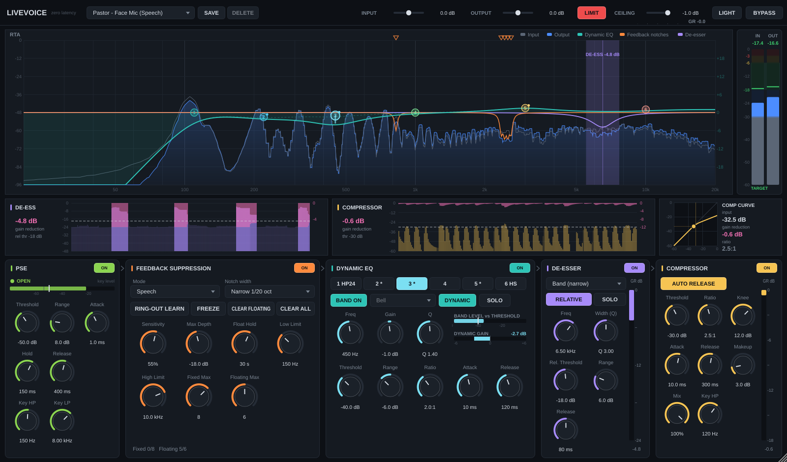
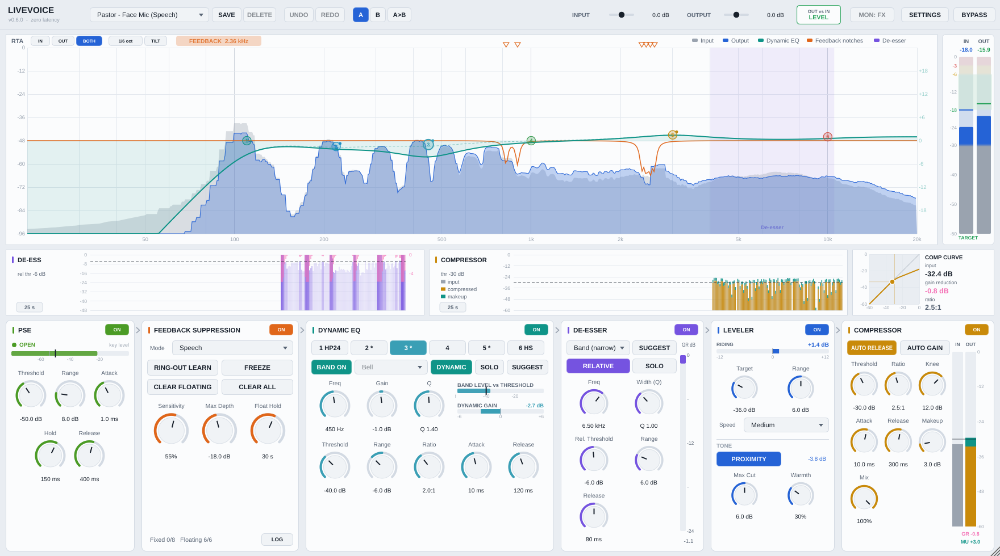
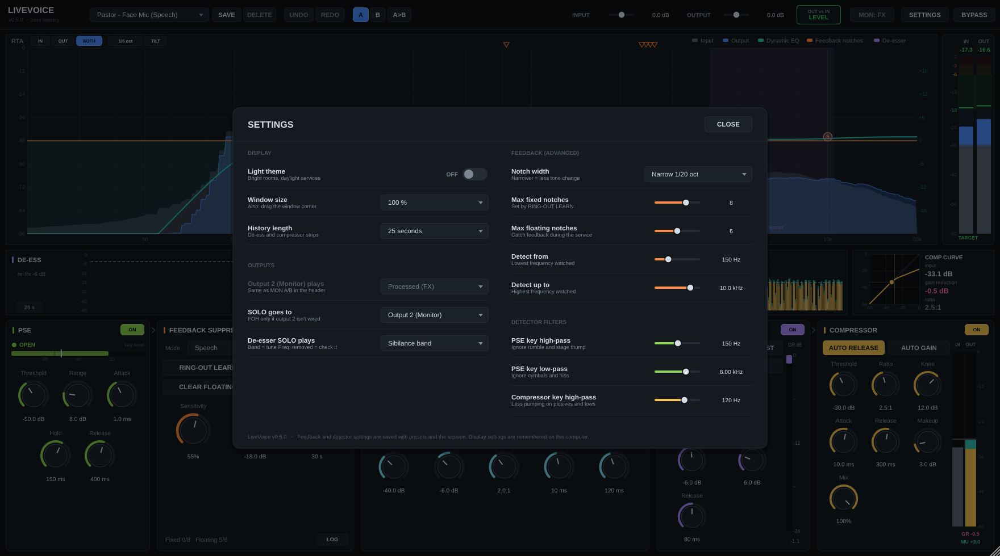

# LiveVoice — zero-latency vocal processor (VST3)  ·  v0.7.0

A single VST3 plugin for live voice: pastor on a face mic, lectern speech, male and female vocals.
Everything in the audio path is zero latency (the plugin reports 0 samples to the host).

| Dark | Light |
|---|---|
|  |  |



## What's in it

**Signal flow** (the bottom panels are laid out in this order, left to right):

Input trim → **High-pass filter** → **PSE** → **Feedback notches** → **6-band Dynamic EQ** → **De-esser** → **Proximity** → **Leveler** → **Warmth** → **Compressor** → Output trim

| Section | What it does |
|---|---|
| **RTA** (top) | Input as a solid grey area, output as a blue area, the live dynamic-EQ curve (teal; dashed = static setting, shown only when the dynamics are moving it), the feedback notch curve (orange) and the de-esser band (quiet violet shading). Buttons: **IN / OUT / BOTH**, smoothing **1/3 · 1/6 · 1/12 oct**, **TILT** (+3 dB/oct, pink noise reads flat). |
| **IN / OUT meters** (right of the RTA) | Vertical peak meters with a colour-zoned scale: grey = too low, blue = quiet but OK, **green = TARGET (-18 to -6 dBFS peaks)**, yellow = hot, red = clip risk. Peak-hold value on top; click to reset. |
| **Middle row** | **De-ess history** (sibilance level, pink reduction from the top, threshold) and **compressor history** (input grey, compressed amber, makeup stacked in teal). They turn grey with an **OFF** tag when that module is switched off. Click the **10 s / 25 s / 60 s** button to change the span. Then the **compressor curve** with a live dot for the input level. |
| **High-pass** (same panel as PSE) | Its own module, first in the chain: Freq (20–400 Hz) and Slope (6–48 dB/oct, default 80 Hz / 24 dB/oct). Removes rumble before the PSE, the feedback detector and everything else hear it. Also a draggable **HP** handle on the RTA. Works with the EQ off. |
| **PSE** | Smoothly turns the mic down between phrases: less bleed and room pickup, less feedback risk while the mic is idle. |
| **Feedback suppression** | Automatic detection + narrow notches. Modes: **Speech**, **Singing**, **Multipurpose**. **LOG** lists every frequency that rang (most frequent first, then all events with times) — copy it out after the service. |
| **Dynamic EQ** | 6 bands at the classic voice spots (120 Hz low shelf, 200 boom, 450 box, 1 k nasal, 3 k presence, 10 k air shelf); band 1 Bell/Low Shelf, band 6 Bell/High Shelf/LP 6-48 dB/oct; proportional dynamics; **SOLO** (the soloed range is shaded on the RTA in the band's colour); **SUGGEST**. |
| **De-esser** | Band (narrow) / Shelf / Wideband, Width, RELATIVE detection, **SOLO**, **SUGGEST**. |
| **Leveler** (+ TONE) | **Leveler:** slowly rides the voice toward a Target level (±Range, Slow/Medium/Fast) before the compressor, so a pastor who turns away or leans in stays steady. It only moves while someone talks and holds between phrases, so it never raises the room. **PROXIMITY:** learns the voice's normal low-end balance and turns the low end down (250 Hz shelf, up to Max Cut) when they get close and it booms. **Warmth:** a little 2nd/3rd harmonic on the low-mids only; 0 % = fully bypassed. |
| **Compressor** | Transparent vocal compressor with **AUTO GAIN** (adds back the average level it takes away, so it doesn't change the overall loudness) and a stacked **IN / OUT** meter: input (grey), compressed level (amber), makeup on top (teal), plus GR and makeup readouts. |
| **Header** | Presets · **UNDO / REDO** · **A / B** settings compare · input/output trim · **OUT vs IN** level indicator · **MON: FX/DRY** (monitor A/B) · **SETTINGS** · BYPASS. Version number under the logo. |

All gain-reduction meters have dB scales and numeric readouts.

### Using the RTA directly
- Drag a numbered EQ handle: left/right = frequency, up/down = gain.
- Mouse wheel over a handle = Q. Double-click a handle = gain back to 0 dB.
- Clicking a handle also selects that band in the EQ panel (and the reverse).
- Click a notch marker (top edge) to **remove** it or **make it fixed**. Hover shows its frequency and depth.

## Dynamic EQ — how the dynamic part behaves
The dynamic cut (or boost) is **proportional**: it grows smoothly as the band gets louder than the threshold instead of switching between "off" and "full range". A 6 dB soft knee eases it in, **Ratio** sets how much it moves per dB over the threshold (2:1 = 1 dB of cut for every 2 dB over), and **Range** is approached gradually rather than hit like a wall. Attack/release smooth the gain itself. The **BAND LEVEL vs THRESHOLD** and **DYNAMIC GAIN** bars in the EQ panel show it working on the selected band, and the handle on the RTA moves with it.

## Outputs: FOH on channel 1, Monitor on channel 2
LiveVoice is a **VST3 plugin** (no standalone app). With a mono mic input it has **one output with two channels**:

| Output pin | Carries |
|---|---|
| **1** (host may call it "Left") | **FOH** — the processed voice |
| **2** (host may call it "Right") | **Monitor** — a copy of FOH normally; the **solo** while SOLO is on; the **dry input** while **MON: DRY** is on |

Wire pin 2 wherever you want it inside LiveProfessor. FOH (pin 1) is never affected by solo or monitor A/B (tested bit-identical). If pin 2 isn't wired, **SETTINGS → SOLO goes to → Output 1 (FOH)** is there for soundcheck use. Solo is never saved with the session, and a flashing **SOLO … CLEAR** banner sits on the RTA while it's on.

Other layouts: mono in → mono out (FOH only, no monitor channel) and stereo in → stereo out (processed stereo, no monitor channel).

## Suggest (de-esser and EQ)
Press **SUGGEST** while the person talks normally; it listens for 20 s (press again to cancel).
- **De-esser:** finds where their "s" energy peaks and how wide it is, sets Freq and Width, and a threshold (absolute and relative) low enough that nearly every "s" gets most of Range, while vowels stay untouched.
- **EQ:** compares the voice's long-term spectrum with its own smoothed trend and suggests a high-pass (set on the HPF module) and **gentle cuts (4 dB max)** where it builds up in the boom / box / nasal / harsh ranges, plus a small air lift only if the voice is dull. Static gains only; your dynamic settings are untouched.

The result appears right in the panel with **KEEP** and **REVERT**: REVERT puts back exactly the values from before the suggestion (it's also one step on the UNDO list). They're starting points — natural voice resonances can show up as small cuts, so listen and adjust.

## Undo, A/B, level match, settings
- **UNDO / REDO** covers every setting change, preset load and Suggest.
- **A / B**: two complete voice settings. Click **B** (it starts as a copy of A), change things, click **A** to compare. **A>B** copies the current one over. Gain and notches are not part of A/B. Both slots are saved with the session.
- **OUT vs IN** (next to OUTPUT) compares the output loudness with the input over the last few seconds of talking. Green **LEVEL** = within 1 dB, so LiveVoice isn't making the voice louder or quieter overall; otherwise it shows the difference. **Click it** to set OUTPUT so they match (undoable).
- **SETTINGS** opens a card with the things you set once: *Display* (light theme, window size / fit to screen, GPU drawing on Windows/macOS, history length), *Outputs* (what output 2 plays, where SOLO goes, whether the de-esser SOLO plays the sibilance band or what it removes), *Feedback (advanced)* (notch width, max fixed / floating notches, detection range) and *Detector filters* (PSE key HP/LP, compressor key HP). Click outside the card or CLOSE to dismiss. The window can also be resized from its corner; the first time it opens it fits itself to your screen.

## Feedback suppression — how to use it at church

1. **Before the service (ring-out):** set the mic where it will be used, turn **RING-OUT LEARN** on, and slowly raise the channel/master gain until rings start. LiveVoice notches each one and marks it *fixed*. Stop when you have a few dB of headroom past your service level, pull the gain back, turn Learn **off**.
2. **During the service:** leave suppression **on**. New rings get *floating* notches, which release automatically after **Float Hold** seconds once the frequency stops ringing.
3. Fixed notches are saved with your host session/snapshot and come back next week. **FREEZE** stops all detection and holds every notch as-is. **CLEAR FLOATING** drops only the in-show notches; **CLEAR ALL** (asks first) also drops the ring-out.

**Modes**
- **Speech** — fastest response (pastor, announcements).
- **Singing** — more patient, so held sung notes are not mistaken for feedback.
- **Multipurpose** — in between, for someone who both speaks and sings.

**Detection** runs on a background thread (FFT on a copy of the audio), so it never adds latency. A peak is called feedback only if it is well above the overall spectrum, much sharper than its neighbourhood, has no harmonics (voices do), is pitch-stable (voices wobble, rings don't) and persists or grows. A fast path catches a rapidly growing, pitch-locked howl before the full persistence time.

**Limits that keep it safe** (in SETTINGS): Fixed Max / Floating Max (up to 12 each), Max Depth (−3 to −30 dB), notch width (1/5 to 1/40 octave, default 1/20), and a Low/High detection range (default 150 Hz – 10 kHz, so the warmth of the voice is never notched).

## PSE — setting it up
Watch the key-level bar while the pastor talks: set **Threshold** just under the softest speech (the white mark), with **Range** 6–12 dB for a natural result. The thin grey mark is where it starts closing (4 dB of hysteresis), and **Hold** keeps it open through short gaps between words. Key HP/LP (in SETTINGS) decide what the PSE listens to (default 150 Hz–8 kHz ignores rumble and cymbals). The bar keeps working with PSE off, so you can set the threshold before switching it on.

## Leveler, proximity and warmth — setting them up
- **Leveler:** when the feedback detector finds a ring, the leveler stops turning up for 4 s (the meter shows **HOLD (FEEDBACK)**); it can still turn down. With the pastor talking normally, set **Target** where the **RIDING** bar sits near 0 dB. **Range** 4–6 dB is plenty; every dB of boost also raises the feedback risk, so don't go wide on a lapel or face mic in a live room. Medium speed for speech; Slow for singing (so it doesn't fight phrasing). The target is a ~0.3 s average including the gaps between words, so it reads well below the peaks (about −28 for healthy −18 to −6 dB peaks).
- **Proximity:** switch it on and let them talk for a few seconds (it learns the normal balance in about 1 s, then keeps adapting slowly). The readout shows the cut it's applying. If someone stays close for minutes it gradually accepts that as their new normal.
- **Warmth:** start around 20–30 % on thin voices; leave it at 0 for already-full voices.

## Compressor — why it's built this way
Aimed at "you don't hear it working": an RMS detector reacts to loudness rather than spikes; a key high-pass (in SETTINGS) stops plosives and proximity boom pumping the voice; a wide soft knee eases in; gain changes are smoothed in the dB domain (the cleanest approach); and AUTO RELEASE behaves like an optical compressor — quick recovery after a short peak, slower and gentler after sustained compression. Starting point: threshold so you see 3–6 dB GR on normal speech, 2.5–3:1, auto release on, **AUTO GAIN** on (or makeup by ear).
Note: makeup gain raises the channel's gain between words too, so it counts toward feedback just like a fader move.

## Presets

Factory: *Default, Pastor – Face Mic (Speech), Spoken Word – Lectern Mic, Male Vocal – Handheld, Female Vocal – Handheld, Worship Leader – Speak & Sing.* They are starting points to adjust at soundcheck, and all use the same band roles (1 HPF, 2 boom, 3 box, 4 nasal, 5 presence, 6 air) so you always know where to reach. All of them except Default switch the compressor on; the speech presets use relative de-essing; PSE is switched on only in the Lectern preset (where nobody may be standing at the mic) and set up but off in the others.

**SAVE** captures your own presets (they appear under *My presets*; **DELETE** removes one). Files live in:
- Windows: `%APPDATA%\LiveVoice\Presets`
- macOS: `~/Library/Application Support/LiveVoice/Presets`

A preset stores the **voice settings** (PSE, feedback behaviour, dynamic EQ, de-esser, compressor). It deliberately does **not** change input/output gain, bypass, Learn/Freeze, or your learned notches — so switching presets mid-service never changes gain staging or forgets the ring-out.

## Building

Requires CMake ≥ 3.22 and a C++17 compiler. JUCE 8.0.10 is downloaded automatically (or pass `-DJUCE_DIR=/path/to/JUCE`).

**Windows** (Visual Studio 2022 with "Desktop development with C++"):
```
cmake -S . -B build
cmake --build build --config Release
```
Copy `build\LiveVoice_artefacts\Release\VST3\LiveVoice.vst3` to `C:\Program Files\Common Files\VST3\`.

**macOS** (Xcode command-line tools; builds a universal Apple Silicon + Intel binary):
```
cmake -S . -B build -G Xcode
cmake --build build --config Release
```
Copy `build/LiveVoice_artefacts/Release/VST3/LiveVoice.vst3` to `~/Library/Audio/Plug-Ins/VST3/`, **replacing** the old one (the build does not install itself). If LiveProfessor still shows an older version under the logo, it is loading an old copy: delete every LiveVoice.vst3 in `~/Library/Audio/Plug-Ins/VST3/` and `/Library/Audio/Plug-Ins/VST3/`, copy the new one in, and rescan plugins in LiveProfessor.
A locally built plugin runs on your own Mac; to give it to other Macs it needs to be code-signed/notarized (or the receiving user must allow it in *Privacy & Security*).

**Building on GitHub (no compiler needed).** Push this folder to a GitHub repository. The included workflow (`.github/workflows/build.yml`) then builds Release VST3s for Windows and macOS (universal) on every push, and runs the offline tests on macOS.
- Every push: open the **Actions** tab → the latest run → **Artifacts** → download `LiveVoice-<version>-macOS-VST3` (or Windows), unzip, and copy `LiveVoice.vst3` into your VST3 folder.
- Push a tag such as `v0.7.0` and the same zips are attached to a **GitHub Release**, so every version you've shipped stays downloadable.
- The version in the zip name comes from `project(LiveVoice VERSION …)` in `CMakeLists.txt`, the same number shown under the logo.
- GitHub's Mac builds are not notarized: the first time, macOS may block the plugin; allow it in System Settings → Privacy & Security, or run `xattr -dr com.apple.quarantine ~/Library/Audio/Plug-Ins/VST3/LiveVoice.vst3`.

### Tests
```
cmake -S . -B build -DLIVEVOICE_BUILD_TESTS=ON
cmake --build build --target LiveVoiceTests --config Release
build/Tests/LiveVoiceTests_artefacts/Release/LiveVoiceTests
```
The suite (98 checks) covers everything from the earlier versions (zero latency, proportional dynamic EQ, all HP/LP slopes, narrow de-esser, relative detection, PSE, compressor, presets, the simulated feedback loop in every mode, false detections, ring-out Learn and recall) plus, new in 0.4.0: **FOH (channel 1) bit-identical while soloing on channel 2**, monitor A/B playing the exact dry input, monitor following FOH otherwise, de-esser Suggest finding the sibilance (6.8 kHz on a 7 kHz test voice) and giving moderate reduction, EQ Suggest finding a planted 450 Hz build-up with gentle cuts, the Suggest capture, undo/redo, and A/B switching and session recall. New in 0.5.0: the de-esser on a harsh synthetic talker (s sounds −5.7 dB, vowels unchanged), Suggest on the same talker, compressor auto gain (−6.1 dB → −0.7 dB) and the output level match. New in 0.6.0: the leveler evening a 15 dB soft/loud difference to ~5.5 dB and holding during silence, proximity compensation (no change at normal distance, about −4.6 dB on a +9 dB low-end boost when close), and warmth (exact bypass at 0 %, 2nd harmonic −20 dB at 100 %, highs untouched). New in 0.7.0: the HPF module's slopes (6–48 dB/oct as designed), the HPF working with the EQ off, the PSE no longer opening on rumble, old presets and sessions moving their band-1 high-pass to the HPF, and the leveler holding while feedback is caught.

`LiveVoiceTests --profile` prints CPU per module and per display part.
`LiveVoiceTests --snapshot out.png [light|toggle]` renders the UI to a PNG (a file name containing `settings` opens the settings card).
`LiveVoiceTests --deess-probe` prints de-esser results for several settings.

## Honest limitations

- **No look-ahead anywhere** (that's the cost of 0 ms).
- **No output limiter** (removed in 0.5.0). Protect the system downstream (LiveProfessor, console or speaker processing).
- The PSE has no look-ahead either; it opens within about 1 ms, which is inaudible on speech, but a very soft first consonant below the threshold can be slightly softened — set the threshold a little low rather than high.
- A notch can only be placed after a ring is detected (typically ~0.1–0.3 s). Ring-out with Learn first; live suppression is the backup, not a substitute for good gain structure and mic placement.
- Detection was tuned on simulated voices and rooms. Expect to adjust Sensitivity in your room — raise it if rings get through, lower it if it notches the voice.

## Code map
```
Source/Params.h                 every parameter + ranges
Source/PluginProcessor.*        signal chain, state (incl. fixed notches), programs
Source/PresetManager.*          factory + user presets
Source/dsp/Svf.h                zero-latency state-variable filters + exact response for drawing
Source/dsp/FeedbackDetector.*   background FFT detector
Source/dsp/FeedbackSuppressor.* notch bank (fixed / floating)
Source/dsp/DynamicEq.h          6-band dynamic EQ
Source/dsp/DeEsser.h            de-esser (band/shelf/wideband, absolute/relative, listen)
Source/dsp/LevelHistory.h       lock-free history for the scrolling strips
Source/dsp/VoiceAnalysis.*      de-esser / EQ Suggest analysis
Source/dsp/PrimarySourceExpander.h  PSE
Source/dsp/HighPass.h           high-pass filter module
Source/dsp/LevelTone.h          leveler, proximity compensation, warmth
Source/dsp/VocalCompressor.h    output compressor
Source/ui/Theme.h               dark + light palettes, look-and-feel
Source/ui/SettingsPanel.*       settings card (switches, drop-downs)
Source/ui/*                     single-page UI
Tests/TestMain.cpp              offline tests + UI snapshot tool
```

## Upgrading from 0.6 or earlier
Sessions, presets and A/B slots saved before 0.7.0 load automatically: a high-pass that was on EQ band 1 moves to the new HPF module (same frequency and slope) and band 1 becomes a flat low shelf. Old settings without a band-1 high-pass load with the HPF off, so they sound exactly as before.
